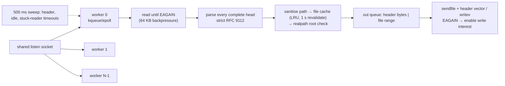

# hearth

An event-loop HTTP/1.1 static file server in C++20, built to match nginx's throughput from about
1,300 lines with no dependencies. It runs one kqueue or epoll loop per thread, serves files
zero-copy with `sendfile`, and supports keep-alive, pipelining, ranges and conditional GET. Its
parser is strict enough to rule out request smuggling, and it defends against slowloris,
clients that stop reading, path traversal and symlink escapes.

[](https://github.com/eshaan2418/hearth/actions/workflows/ci.yml)
[](LICENSE)


```
$ make demo
$ curl -si -H 'Range: bytes=4-9' http://127.0.0.1:18099/digits.txt
HTTP/1.1 206 Partial Content
Server: hearth
Content-Type: text/plain; charset=utf-8
Content-Length: 6
ETag: "6ae8dbc8-10"
Accept-Ranges: bytes
Content-Range: bytes 4-9/16

456789
$ curl -si --path-as-is http://127.0.0.1:18099/../../etc/passwd
HTTP/1.1 400 Bad Request
...
$ hearth-load 127.0.0.1 18099 /index.html 8 2
{"connections":8,"path":"/index.html","requests":274810,"rps":137405,"mb_per_s":3.7,"p50_us":50,"p99_us":146,"p999_us":1050,"non200":0}
```

(`Date` and `Last-Modified` lines are omitted from the demo output.)

## Why this exists

A static file server is the smallest program that has to get every hard part of a network
server right:
- non-blocking I/O and readiness notification;
- output queues with backpressure;
- zero-copy file transfer;
- keep-alive and pipelined request ordering;
- timeouts that survive hostile clients;
- a parser that cannot be confused into request smuggling.

nginx is the obvious bar. The question this project answers is how close a small, readable
implementation can get, and what it takes to get there.

## Highlights

- **On par with nginx 1.31.8** at equal worker counts. In the quieter of two benchmark passes,
  the medians are:
  - 1 KB files: 91.7k vs 94.0k req/s;
  - 100 KB files: 51.9k vs 52.0k req/s;
  - 1 MB files: 13.8 vs 12.8 GB/s.

  All runs had 0 errors.
- **Zero-copy.** File bodies are queued as `(fd, offset, length)` and sent with `sendfile`, with
  the response headers in the same call (`sf_hdtr` on macOS, `MSG_MORE` on Linux). Small
  pipelined responses are batched into one `writev`.
- **Strict RFC 9112 parsing.** The parser returns 400 for duplicate or conflicting
  Content-Length, Transfer-Encoding with Content-Length, bare LF, obs-fold, whitespace before
  the colon, and a missing or duplicate Host. It returns 431 or 414 for oversized heads, 501 for
  chunked uploads, and 505 for unknown versions. It was fuzzed for 25 million inputs under
  ASan and UBSan with no failures.
- **Hostile-client defences.** These are all integration-tested:
  - a header timeout measured from the first byte of the head, which stops slowloris;
  - closing clients that stop reading;
  - 16 KB head limits and 64 KB input backpressure;
  - lexical rejection of `..` and `%2e%2e`;
  - a `realpath` check that blocks symlinks out of the root.
- **Correct HTTP semantics.**
  - Keep-alive follows HTTP/1.0 and 1.1 rules.
  - Pipelined responses always come back in order.
  - Single ranges return 206, and unsatisfiable ones 416.
  - `If-None-Match` and `If-Modified-Since` return 304.
  - Directories redirect with 301 to `dir/`, and `index.html` is served.
- **Graceful stop.** It stops accepting, drains in-flight responses (tested with a 3 MB transfer
  stopped mid-flight), then exits.

## Quick start

```sh
git clone https://github.com/eshaan2418/hearth && cd hearth
make test                  # 17 tests: parser, sanitiser, and live-server integration
make build && build/hearthd -root ./public -port 8080
```

You need CMake 3.24 or later, Ninja and Clang (or GCC). GoogleTest is used if installed and
fetched otherwise. Works on macOS (kqueue) and Linux (epoll).

## Usage

```
hearthd -root DIR [-host 127.0.0.1] [-port 8080] [-threads N] [-idle-timeout-ms 60000]
```

SIGINT or SIGTERM drains for up to 5 s, then exits. As a library:

```cpp
hearth::Options o;
o.root = "/srv/www";
o.port = 0;           // pick a free port
hearth::Server s(o);
s.Start();            // spawns the worker threads
int port = s.port();
// ...
s.Stop(5000);         // drain up to 5 s
```

`hearth-load HOST PORT PATH CONNECTIONS SECONDS` is the bundled closed-loop keep-alive load
generator. It prints one JSON line with req/s, MB/s, latency percentiles and a count of non-200
responses.

## Architecture



Each worker owns its poller, connections and file cache, and nothing mutable is shared.
[docs/DESIGN.md](docs/DESIGN.md) covers the state machine, output path, cache, path safety and
parser rules. [docs/DEEP_DIVE.md](docs/DEEP_DIVE.md) answers the design questions.

## Benchmarks

hearth and nginx serve the same random-content files from the same directory, with 4 workers
each.
- The nginx config is tuned the usual way: `sendfile`, `tcp_nopush`, `open_file_cache`,
  `access_log off`, and effectively unlimited keep-alive requests.
- `hearth-load` holds N keep-alive connections, one thread each, for 5 s after a 0.5 s warm-up.
- The servers alternate within every repetition, 5 repetitions per cell, and each cell
  reports the median.
- Hardware: Apple M5 Pro (18 cores), macOS, loopback TCP, nginx 1.31.8.
- **Machine load:** other jobs were running throughout (recorded per run as `load`), so
  absolute numbers are depressed and noisy. Read the comparison, not the absolute figures.

**Pass 2** (quieter machine, load 11–15), from `bench/results/summary-run2.md`:

| file | conns | server | req/s | throughput | p50 | p99 | errors |
|---|---:|---|---:|---:|---:|---:|---:|
| 1 KB | 64 | hearth | 91,694 | 94 MB/s | 691 µs | 995 µs | 0 |
| | | nginx | 94,025 | 96 MB/s | 655 µs | 871 µs | 0 |
| 100 KB | 64 | hearth | 51,892 | 5.3 GB/s | 1,232 µs | 1,466 µs | 0 |
| | | nginx | 52,036 | 5.3 GB/s | 1,218 µs | 1,450 µs | 0 |
| 1 MB | 16 | hearth | 13,140 | 13.8 GB/s | 1,189 µs | 2,641 µs | 0 |
| | | nginx | 12,235 | 12.8 GB/s | 1,259 µs | 2,134 µs | 0 |

**Pass 1** (busier machine, load 17–29), from `bench/results/summary-run1.md`:

| file | conns | server | req/s | throughput | p50 | p99 | errors |
|---|---:|---|---:|---:|---:|---:|---:|
| 1 KB | 64 | hearth | 24,973 | 26 MB/s | 345 µs | 93,825 µs | 0 |
| | | nginx | 23,506 | 24 MB/s | 423 µs | 100,248 µs | 0 |
| 100 KB | 64 | hearth | 35,147 | 3.6 GB/s | 1,279 µs | 2,861 µs | 0 |
| | | nginx | 35,830 | 3.7 GB/s | 1,572 µs | 2,819 µs | 0 |
| 1 MB | 16 | hearth | 13,678 | 14.3 GB/s | 1,170 µs | 2,234 µs | 0 |
| | | nginx | 13,641 | 14.3 GB/s | 1,217 µs | 1,510 µs | 0 |

What the numbers say:
- **hearth and nginx are within a few percent in every cell of both passes**, and neither leads
  consistently. On 1 KB files nginx is 2.5% ahead in pass 2 and hearth 6% ahead in pass 1. On
  1 MB files hearth is ahead in both, by 7% and 0.3%.
- **The noise is larger than the differences.** In pass 1, 1 KB throughput collapsed to about
  25k req/s for *both* servers, with a 95 ms p99. That is 64 load-generator threads plus 8
  server threads competing with a saturated machine for cores, so the run measures the
  scheduler, not the servers. It is reported because it happened.
- **On 1 MB files both servers reach 13–14 GB/s over loopback**, and the per-request work is
  negligible next to the copy. I did not profile what sets that ceiling.

**Ablation: response headers in the same `sendfile` call.** An early, noisy pass suggested
hearth was behind on 100 KB files. Separate header writes were the obvious suspect, so I
measured the commit before and after that change, interleaved, 5 runs each
(`bench/results/summary-ablation.md`):

| file | build | req/s (median) | individual runs |
|---|---|---:|---|
| 1 KB | separate header `write` | 126,329 | 127.5k, 126.3k, 134.4k, 123.7k, 125.8k |
| | headers in `sendfile` | 128,592 | 130.0k, 128.6k, 128.6k, 128.7k, 127.2k |
| 100 KB | separate header `write` | 84,698 | 74.1k, 88.2k, 81.2k, 84.7k, 86.8k |
| | headers in `sendfile` | 82,242 | 81.1k, 85.6k, 80.0k, 82.2k, 86.9k |

There is no measurable difference: the run ranges overlap completely. The change is kept
because it removes a system call per response, not because it is faster. The early gap was
background load (see DEEP_DIVE question 6).

Raw JSONL for every run, with load recorded, is in `bench/results/`. To reproduce, run
`make bench` (it needs `nginx` on PATH) on an idle machine if you can.

## Design decisions and trade-offs

- **Loops per thread, not a pool.** Each connection stays on one core with no locks or hand-offs.
  The cost: a cold `open()` on slow storage stalls that loop.
- **Shared listen socket.** It balances itself, at the cost of a small accept thundering herd.
  `SO_REUSEPORT` on Linux would remove it.
- **Parse only complete heads.** The parser is stateless and easy to fuzz. Re-scanning a
  partial head is cheap and bounded by the 16 KB limit and the header timeout.
- **Reject instead of normalise.** `..`, conflicting lengths and odd whitespace get 400, never
  a guess. Compliant clients never send them, and guessing is where smuggling comes from.
- **Per-worker file cache with 1 s revalidation**, the same model as nginx's
  `open_file_cache_valid`. Edits show up within a second, and in-flight transfers keep the old
  inode.
- **Level-triggered with write interest toggled.** It is simpler than edge-triggered (no
  must-drain invariants) and costs nothing for idle connections.

## Testing

- **Parser and sanitiser** (`tests/test_http.cpp`):
  - valid requests and keep-alive rules;
  - every smuggling vector in the DESIGN table, plus size limits;
  - percent-decoding, traversal and encoded traversal, NUL and backslash;
  - MIME types.
- **Live-server integration** (`tests/test_server.cpp`, raw sockets against a real server):
  - headers, index files and the directory redirect;
  - HEAD, 404 and 405;
  - traversal, and a planted symlink escape;
  - a 3 MB file byte-for-byte;
  - 304 by ETag and by date;
  - suffix, open-ended and 1 MB ranges, and 416;
  - 22 pipelined requests in order;
  - malformed requests giving 400 and a close;
  - slowloris and idle timeouts;
  - 16 concurrent clients doing 3,200 requests;
  - graceful drain of an in-flight transfer.
- **Sanitizers.** All tests pass under ASan + UBSan and under TSan (`make asan`, `make tsan`), and
  the integration suite passed 10 of 10 repeated runs.
- **Fuzzing.** libFuzzer with ASan and UBSan on the parser and sanitiser ran 24,985,622 inputs
  in 301 s with no failures (`bench/results/fuzz.txt`). CI fuzzes for 60 s on every push.
- **CI** on macOS and Ubuntu runs tests, ASan, TSan, the demo, fuzzing and clang-format.

## Limitations and roadmap

- No TLS, no HTTP/2, no compression, no directory listings, no access log.
- Multi-range requests are answered with the whole file (RFC 9110 allows ignoring `Range`).
- Request bodies are discarded, and chunked uploads get 501. That is right for a static server
  but means the code is not a general HTTP server.
- `open`/`stat` run on the event loop, so they block it on slow storage.
- Roadmap:
  - kTLS (Linux) to keep zero-copy with TLS;
  - precompressed `.br`/`.gz` variants;
  - an async open pool;
  - a timer wheel;
  - `SO_REUSEPORT` listeners;
  - access logs and metrics.

## Project structure

```
include/hearth/   public API: server.h (Server, Options), http.h (parser, sanitiser, MIME)
src/http.cpp      strict request parser, path sanitiser, reason phrases, MIME table
src/server.cpp    poller (kqueue/epoll), workers, connection state machine, file cache, output
tools/hearthd     the server binary
tools/load        hearth-load, closed-loop keep-alive load generator
tests/            parser unit tests and live-server integration tests (GoogleTest)
fuzz/             libFuzzer target for the parser and sanitiser
bench/            nginx comparison, ablation, demo scripts; results/ holds raw data
```

## License

MIT. See [LICENSE](LICENSE).
